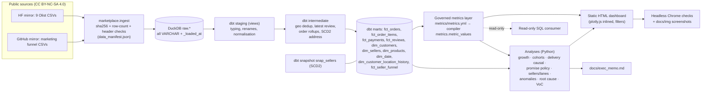
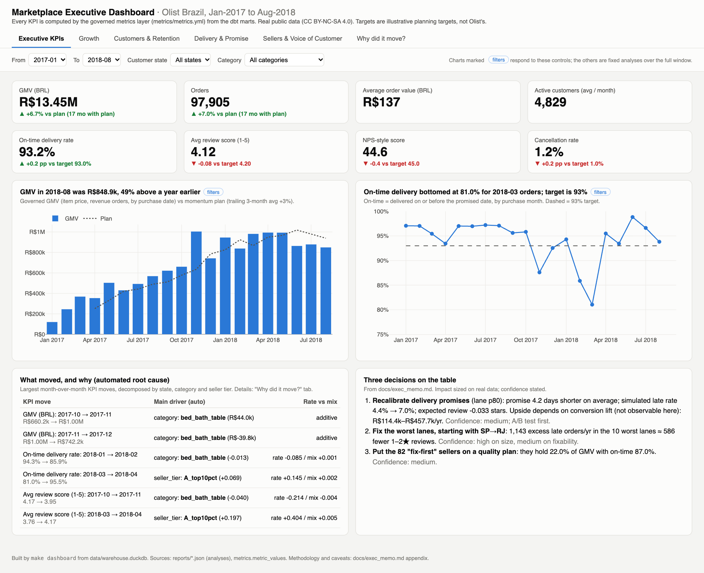

# Marketplace analytics: raw OLTP tables → governed metrics → executive BI → decisions

An end-to-end analytics-engineering and BA project on the **real Olist Brazilian marketplace data**
(99,441 orders, 2016–2018). It is built the way a large-company analytics team would build it:
a dbt + DuckDB Kimball star schema with tests, a single governed metrics layer, a set of senior-BA
analyses with causal designs, a self-contained executive dashboard, and a one-page VP memo.

**The business question:** *GMV is growing fast. Is that growth healthy, what is
hurting customers, and which three things should the marketplace do next?*

It goes past the usual Olist EDA in five ways:
1. **Delivery-promise calibration.** Olist pads its promised dates by a median of 12 days. Quantile
   models are retrained monthly with no look-ahead, and five promise policies are simulated on
   held-out months, valued with a causal estimate of what a broken promise costs.
2. **Automated KPI root cause** in the style of ThirdEye/Adtributor: a mix-vs-rate decomposition across
   state, category and seller tier, ranked by surprise, with a Simpson's-paradox scan.
3. **Voice of customer** from 40,514 real Portuguese reviews, validated against 400 hand-labelled ones.
   It shows the #1 complaint on *on-time* orders is partial shipment.
4. **Causal rigor** on lateness → reviews/repurchase: fixed effects within seller × month, a
   same-delivery-time design, and a regression discontinuity with placebo and density checks.
5. **Metric governance:** real cases where two reasonable definitions of the "same" KPI
   disagree (April-2018 on-time: 95.5% vs 82.9%), and how the governed definition settles it.

## Architecture



## Data sources and license
| Dataset | Original | Mirror used | License |
|---|---|---|---|
| Olist Brazilian E-Commerce (9 tables) | [Kaggle: olistbr/brazilian-ecommerce](https://www.kaggle.com/datasets/olistbr/brazilian-ecommerce) | [HF: aviahYadler/Olist_Ecommerce_Dataset](https://huggingface.co/datasets/aviahYadler/Olist_Ecommerce_Dataset), byte-checked against 2 other mirrors | CC BY-NC-SA 4.0 |
| Olist Marketing Funnel (2 tables) | [Kaggle: olistbr/marketing-funnel-olist](https://www.kaggle.com/datasets/olistbr/marketing-funnel-olist) | [GitHub: mara/mara-olist-ecommerce-data](https://github.com/mara/mara-olist-ecommerce-data), byte-checked against patterns-app/public_data | CC BY-NC-SA 4.0 |

All row counts match the published originals (orders 99,441; items 112,650; payments 103,886;
reviews 99,224; customers 99,441; sellers 3,095; products 32,951). See
[docs/DATA_PROVENANCE.md](docs/DATA_PROVENANCE.md). Raw data is not committed.

## How to run
```bash
uv venv --python 3.12 && uv pip install -r requirements.lock   # or: make setup
make all          # download+verify → dbt build → freshness → docs → metrics → analyses
                  # → VoC → results → dashboard → screenshots → pytest → ruff
open dashboard/index.html
```
Targets you can run on their own: `make ingest dbt metrics analyses dashboard screenshots test lint`.
`make voc-relabel` re-runs the optional LLM labelling with local Ollama `qwen2.5:7b` (about 1 h;
it needs about 5 GB of free memory). Docker: `docker build -t marketplace-analytics . && docker run --rm marketplace-analytics`.
CI: `.github/workflows/ci.yml` (written; not run remotely).

## Results (real numbers; every row is regenerated in [docs/RESULTS.md](docs/RESULTS.md) with its source field)
| Area | Result |
|---|---|
| dbt | `dbt build`: **0 errors**, 144 pass + 1 intentional WARN (payment-reconciliation exceptions: 20 orders, below the 0.5% error threshold); all 11 sources pass freshness |
| Scale | GMV R$13.49M; 98,199 revenue orders; AOV R$137; on-time 93.2%; review 4.12; NPS-style 44.5 |
| Growth | GMV Jan–Aug 2018 **+138% YoY**. Customers +139%, orders/customer −0.6%, AOV +0.4% (exact LMDI, residual 1e-16) |
| Retention | 3.0% of people ever order twice; 1.9% on a later day within 180 d (Kaplan–Meier); repeat orders = 2.9% of GMV; 30% of "next orders" are same-day split baskets |
| Lateness → review | naive −2.02; FE −1.92; **same seller × month −1.89** [−1.95, −1.84]; same delivery time, broken promise −1.26; RD at the promise −0.24 (±5 d; density check fails → supporting only) |
| Lateness → repurchase | base 1.84% (180 d after delivery); effect −0.29 pp [−0.75, +0.17], so not significant; ≈ R$2.2k/yr of repeat GMV |
| Promise | median padding **12 days**, 74% of orders > 7 days early. Rolling quantile GBM beats lane quantiles on pinball loss (P90 1.38 vs 1.57; Olist 1.61). Coverage is P80 91% / P90 95% (target 80/90: **over-covers**; ±0.4 pp run-to-run from multithreaded GBM). Recommended lane-P80: **−4.2 days** promise, late 4.4% → 7.0%, review −0.03 |
| Sellers | top-10% sellers = 66% of GMV; 19% of sellers = 80% of GMV; HHI 38 (unconcentrated); 82 "fix-first" sellers hold 22% of GMV at 87% on-time |
| Lanes | SP→RJ: 6,175 orders, 17.6% late vs 7.8% network, 608 excess late orders; 10 worst lanes = 1,143 excess late orders ≈ 586 avoidable 1–2★ reviews |
| Monitoring | online STL monitor: 16 alerts in 20 months, 10 needing a human. Black Friday 2017 = 1,166 orders (4.8× expected), classified as an expected event. Catches the Aug-2018 data-feed cut-off |
| Root cause | Feb-2018 on-time drop 94.3% → 85.9%: rate −8.5 pp vs mix +0.05 pp, with 95% of volume in segments that got worse. Simpson reversals: 7 of 114 cases, 0 material |
| VoC | rules on 40,514 reviews: **70.6%** accuracy on a fresh 160-review holdout (macro-F1 0.61; majority baseline 27.5%). Late/not-received label rate is 52% on late orders vs 3.8% on on-time orders. Incomplete order is the #1 complaint on on-time orders (22%) |
| Governance | repeat rate 3.04% (customer_unique_id) vs 0.00% (customer_id); April-2018 on-time 95.5% (purchase cohort) vs 82.9% (delivery month); GMV with freight +R$2.24M |

Headline recommendations with sized impact: [docs/exec_memo.md](docs/exec_memo.md).
Screenshots: `docs/img/dashboard_*.png`.



## Repository map
| Path | What |
|---|---|
| `src/marketplace/ingest.py` | EL step: download, sha256/row/header verification, land `raw.*` |
| `dbt/` | staging → intermediate → marts, snapshot, seeds, 115 data tests, exposures, source freshness |
| `metrics/metrics.yml` + `src/marketplace/metrics.py` | governed metrics layer (17 metrics) and compiler; `docs/metrics_catalog.md` is generated |
| `src/marketplace/metric_conflicts.py` | the "same KPI, two definitions" report |
| `src/marketplace/analysis/` | growth, cohorts, delivery_impact, promise_policy, sellers (+lanes), anomalies, root_cause, voc |
| `src/marketplace/dashboard/` | dashboard builder, template, JS app, headless-Chrome checker |
| `docs/` | ACCEPTANCE (criteria + PASS/FAIL), DATA_QUALITY (generated, 32 checks), DATA_PROVENANCE, RESULTS (generated), metrics_catalog (generated), exec_memo |
| `artifacts/` | VoC sample keys, gold labels (A: 240, B: 160), cached LLM labels, rule labels |

## For downstream consumers (e.g. a read-only SQL consumer)
- Warehouse: **`./data/warehouse.duckdb`** (stable path). Open it
  read-only: `duckdb.connect(path, read_only=True)`. Schemas: `marts` (facts and dims), `metrics`
  (`metric_values`: metric × grain[day|month|all] × period; `metric_definitions`), `reference`
  (seeds), `snapshots`, `staging`, `intermediate`, `raw`.
- Metric definitions: **`./metrics/metrics.yml`**. Use
  `MetricsLayer.load().compile(name, grain, where=...)` to get the governed SQL instead of
  writing formulas. Rejected alternatives are listed in the same file.
- Do not open the file for writing while `make` is running (DuckDB allows a single writer).

## How this maps to production at a large company
- **Kimball dimensional modelling.** Conformed dims and transaction-grain facts, with an SCD2 address
  history (R. Kimball & M. Ross, *The Data Warehouse Toolkit*, 3rd ed., Wiley 2013).
- **dbt Labs best practices.** The staging/intermediate/marts layering and naming follow
  ["How we structure our dbt projects"](https://docs.getdbt.com/best-practices/how-we-structure/1-guide-overview).
  The project also uses tests, source freshness, exposures and snapshots.
- **Governed metrics.** One definition, consumed everywhere, as in Airbnb's Minerva
  (["How Airbnb achieved metric consistency at scale"](https://medium.com/airbnb-engineering/how-airbnb-achieved-metric-consistency-at-scale-f23cc53dea70))
  and the [dbt Semantic Layer / MetricFlow](https://docs.getdbt.com/docs/use-dbt-semantic-layer/dbt-sl).
  Here a small YAML compiler plays that role.
- **Data team handbooks.** GitLab's public [data team handbook](https://handbook.gitlab.com/handbook/enterprise-data/)
  (dbt guide, trusted data framework, KPI definitions with owners). Shopify's data engineering
  posts on dbt and modelling standards ([shopify.engineering](https://shopify.engineering/)).
- **Root cause.** LinkedIn ThirdEye (open-sourced anomaly detection and root-cause analysis) and
  Bhagwan et al., *Adtributor: Revenue Debugging in Advertising Systems* (NSDI 2014), the source
  of the explanatory-power and surprise (JS divergence) ranking used here.
- **Promise calibration.** Retailers' delivery-date promises are quantile forecasts. The conversion
  upside assumption comes from Fisher, Gallino & Xu, *The Value of Rapid Delivery in Omnichannel
  Retailing*, J. Marketing Research 56(5), 2019: +1.45% sales per business day faster. Conformalised
  quantiles follow Romano, Patterson & Candès, *Conformalized Quantile Regression*, NeurIPS 2019.
- **Monitoring.** STL decomposition (Cleveland et al., 1990) with robust z-scores on one-step-ahead
  errors and an event calendar, the usual "expected vs actual with known-event suppression" pattern
  in BI alerting.

## Known limitations / what differs from production
- **Static extract.** One 2016–2018 snapshot. The dbt snapshot and freshness checks are wired, but
  real SCD2 history needs repeated loads, and freshness is measured on the landing timestamp.
- **No cost, margin, refund, traffic or conversion data.** BRL sizing covers GMV and repeat GMV only.
  The promise upside rests on an external elasticity and needs an A/B test.
- **Promise model coverage over-shoots** (P80 91%, P90 95%) because delivery kept speeding up in
  2018. A production model would add drift-aware recalibration on a shorter feedback window.
- **RD design is supporting evidence only:** orders bunch just before the promised date (density
  ratio 0.64 vs 0.88), which violates the no-manipulation assumption, and one of three placebo
  cutoffs (−4.5 d) is significant at p = 0.04 (−0.08 stars).
- **VoC gold labels** were made by the author, with gold A seen
  before the rules were written. The fresh holdout B (70.6%) is the honest number. The LLM run was
  cut short by memory pressure on a shared laptop (400 of 3,000 sampled reviews).
- **Targets are illustrative**, set by the analyst (Olist's are not public).
- **Streamlit was skipped** on purpose: the static HTML dashboard is the reproducible artifact and
  avoids a server dependency.
- dbt-duckdb runs on one machine. In production the same project would target Snowflake or
  BigQuery, with orchestration (Airflow/Dagster) and a proper BI tool.
