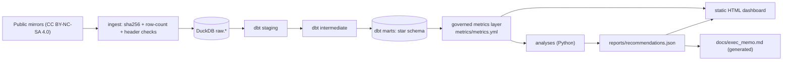

# Marketplace analytics on real Olist data: what a late delivery really costs

**The strongest finding: most of the star penalty for a late delivery is a survey-timing artefact.**
Olist sends its satisfaction survey about 2 days after the *promised* date, delivered or not, so
70% of late orders are rated before the parcel arrives. Comparing the same seller in the same month,
a late order records **−1.89★**. On reviews written *after* the parcel arrived it is **−0.51★**.
Lateness that comes only from the carrier leg gives −0.54★, and the May-2018 truckers' strike, used
as a natural experiment, gives −0.49★ (wide CI). The cheapest fix is product, not logistics:
**send the survey on confirmed delivery**, which is worth up to 2,215 fewer 1–2★ reviews a year
(upper bound).


## What this repo is
An end-to-end analytics-engineering and business-analysis project on the public Olist Brazilian
marketplace data (99,441 orders, 2016–2018):



- **dbt + DuckDB star schema.** Facts at order, item and payment grain; a person-level customer
  dimension; an SCD2 address history. Five business-rule tests carry the trust:
  - payments reconcile to items + freight (instalment interest is the allowed exception);
  - delivery is never before purchase;
  - GMV is conserved from staging to marts;
  - SCD2 validity windows never overlap;
  - the item fact carries no un-prefixed order-level measures (fan-out guard).
- **Governed metrics layer.** One YAML file holds each KPI's definition, owner, grain and caveats,
  plus the rejected alternatives. Example: April-2018 on-time is 95.5% counted by purchase month
  but 82.9% counted by delivery month.
- **Analyses.**
  - Growth from the seller side.
  - Survey-timing-aware delivery effects with carrier-leg and strike designs.
  - A promise-policy backtest over a full year, including the peak.
  - Process-stage root cause.
  - An in-flight lateness monitor.
  - Complaint reasons from Portuguese review text, corrected for misclassification.
- **Deliverables.**
  - A 6-page offline dashboard (`dashboard/index.html`).
  - A generated one-page VP memo, [docs/exec_memo.md](docs/exec_memo.md).

## Three results (all numbers: [docs/RESULTS.md](docs/RESULTS.md), each with its source field)
| Question | Answer (window stated) |
|---|---|
| Is growth healthy? | No. GMV has been flat since Nov-2017, and Jun–Aug 2018 is 12.7% below Mar–May. Active sellers rose 1,072 → 1,226 while GMV per seller fell R$923 → R$704/month, so demand is the constraint. "+138% YoY" (Jan–Aug) is a ramp-up base effect. |
| Should promises be shorter? | Not network-wide. Olist pads by a median of 12 days, but over Oct-2017–Aug-2018 (never-delivered orders counted as late) a lane-P80 promise saves 6.4 days and raises the late rate from 9.3% to 20.6%. The pre-set rule, applied on the Oct–Mar selection period, picks a drift-aware recalibration that lengthens peak promises. The recommendation is a capped A/B test. |
| What hurts customers on orders that arrive on time? | Incomplete orders (23.4%, CI 19.4–27.1) and poor quality (20.4%, CI 13.3–28.7) lead the 1–2★ reviews of on-time orders after misclassification correction. 65% of incomplete-order complaints are on multi-item orders, which are 12% of reviews. |

## How to run
```bash
uv venv --python 3.12 && uv pip install -r requirements.lock   # or: make setup
make all        # verify raw data → dbt build → metrics → analyses → memo → dashboard → checks → tests
open dashboard/index.html
```
`make voc-relabel` re-runs the optional local LLM labelling (Ollama `qwen2.5:7b`). The Dockerfile
and `.github/workflows/ci.yml` are written but have not been run remotely.

## Data and license
- [Olist Brazilian E-Commerce](https://www.kaggle.com/datasets/olistbr/brazilian-ecommerce) and
  [Olist Marketing Funnel](https://www.kaggle.com/datasets/olistbr/marketing-funnel-olist), CC BY-NC-SA 4.0.
- Downloaded from public mirrors and checked byte-for-byte against independent copies. Row counts
  match the published originals. See [docs/DATA_PROVENANCE.md](docs/DATA_PROVENANCE.md).
- Raw data is not committed. 32+ data-quality checks are generated in
  [docs/DATA_QUALITY.md](docs/DATA_QUALITY.md).

## Reading the warehouse
`data/warehouse.duckdb` (stable path, open read-only). Schemas: `marts`, `metrics.metric_values`,
`reference`, `snapshots`. Use `MetricsLayer.load().compile(name, grain, where=...)` to get governed SQL.
Columns prefixed `order_` on `marts.fct_order_items` are order-level and must not be aggregated at
item grain.

## Known limitations
- **Review effects are bounds, not one number.** Post-delivery reviews are a selected group, and the
  same-delivery-time design conditions on a mediator. The regression discontinuity at the promise
  date fails: deliveries bunch just before the promise, and the survey timing switches at the same
  cutoff. It is kept only as a falsification exhibit.
- **Repurchase is underpowered.** The effect is −0.29 pp, but the MDE is 0.66 pp (36% of the base),
  so this is not evidence of "no effect".
- **No BRL attaches to reviews.** A seller-week panel finds no detectable link from bad reviews to
  the seller's next-4-week GMV (−R$13 per review, CI −62 to +36).
- **Promise coverage is miscalibrated in both directions.** Model P90 covers about 80% in the
  Oct–Mar peak and about 95% in Apr–Aug (exact values in RESULTS.md).
- **The conversion benefit of shorter promises is not measurable here.** There are no sessions in
  the data, so only break-even elasticities are given.
- **No carrier identifier.** Carrier-level counterfactuals are impossible.
- **Text labels.** The keyword classifier is scored against a single-annotator labelled set; a
  blind second pass on 50 reviews (`artifacts/voc_author_verification_template.csv`, scored with
  `python -m marketplace.analysis.voc rescore <file>`) measures label noise.
- **The SCD2 address history is a demonstration.** No fact table joins to it point-in-time yet.
- **The extract may be a sample** ("100k orders" per Olist). Nov-2016 is missing and capture ends on
  2018-08-29.

Production mapping and citations (Kimball, dbt Labs, Airbnb Minerva, ThirdEye/Adtributor, Fisher et
al. 2019): [docs/PRODUCTION_MAPPING.md](docs/PRODUCTION_MAPPING.md).
